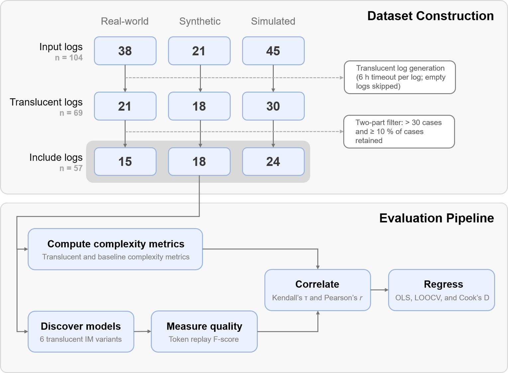

# Translucent Log Complexity

Implementation accompanying the paper

> **Complexity of Translucent Event Logs and their Impact on Process Discovery**
> _Under review._

A classical event log records only the activity executed at each event. A **translucent event log** also records the set of activities that were _enabled_ at that moment, i.e., the alternatives that could have been executed instead. Existing log complexity metrics ignore this information: two logs with identical traces but different enabled activities receive identical values.

This repository provides:

- four **translucent complexity metrics** that quantify the complexity of the enabled-activity sets in a translucent event log, and
- an **evaluation pipeline** that relates these metrics to the quality of process models discovered by six variants of the translucent Inductive Miner, and compares them with established complexity metrics.



## Complexity Metrics

| Dimension   | Metric                         | Label     | Name in code                               |
| ----------- | ------------------------------ | --------- | ------------------------------------------ |
| Scale       | Scale-based complexity         | `scale-c` | `average` (`complexity_avg_raw`)           |
| Diversity   | Diversity-based complexity     | `div-c`   | `diversity` (`complexity_div`)             |
| Variability | Dispersion-based complexity    | `disp-c`  | `dispersion` (`complexity_disp`)           |
| Variability | Dissimilarity-based complexity | `diss-c`  | `dissimilarity` (`complexity_diss_aa_seq`) |

- **Scale** is the average number of enabled activities per event. The code calls it _average-based complexity_ and also provides a normalized variant (`avg_type="norm"`, `complexity_avg_norm`); the paper uses only the raw variant.
- **Diversity** is the average number of distinct enabled-activity sets per executed activity.
- **Dispersion** is the average spread of the binary-encoded enabled-activity sets of each activity around their centroid.
- **Dissimilarity** is the average semantic distance between the enabled-activity sets of each activity, computed by optimal matching over count-based activity distances from [semantic-aware-process-mining-distances](https://github.com/henrikkirchmann/semantic-aware-process-mining-distances) (activity-activity co-occurrence, sequence context, PPMI, window size 3).

As baselines, established complexity metrics for classical event logs are computed with [process-complexity](https://github.com/MaxVidgof/process-complexity). The regression analysis uses average trace length, Lempel–Ziv complexity, average affinity, and normalized sequence entropy, with the number of activities as a control variable.

## Setup

Python 3.10 is required. Run from the repository root:

```bash
python -m venv venv
source venv/bin/activate        # Windows: venv\Scripts\Activate.ps1
pip install -r requirements_local.txt
python install_external_requirements.py
```

Third-party code is used through the git submodules in `external/`. The scripts add these submodules to the Python path themselves.

## Usage

The metrics take a pm4py-style DataFrame whose `enabled_activities` column holds comma-separated activity names:

```python
import pandas as pd
from src.complexity_measurements.measure_complexity import measure_complexity

measure_complexity(df, "average")        # scale-c
measure_complexity(df, "diversity")      # div-c
measure_complexity(df, "dispersion")     # disp-c
measure_complexity(df, "dissimilarity")  # diss-c (method="aa", ngram_size=3 by default)
```

## Reproducing the Experiments

Each step is a script under `scripts/`. [`scripts/scripts.txt`](scripts/scripts.txt) lists the exact commands in order:

1. **Simulate logs** from random process trees: `scripts/simulated_generation/run_generation.py`
2. **Generate translucent logs** with the alignment-based approach: `scripts/translucent_generation/run_generation.py`
3. **Compute translucent and baseline complexity**, and the **model quality** (token-based replay F-score) of the six discovered models per log: `scripts/evaluation/run_*.py`
4. **Analyze**: correlation (Kendall's τ, Pearson's r), regression, LOOCV, and influence diagnostics: `scripts/evaluation/` and [`notebooks/experiment.ipynb`](notebooks/experiment.ipynb)

## Acknowledgements

This work builds on the following third-party repositories, included as git submodules under `external/`:

- [TranslucentActivityRelationships](https://github.com/hherbertb/TranslucentActivityRelationships): translucent log generation and the translucent Inductive Miner.
- [semantic-aware-process-mining-distances](https://github.com/henrikkirchmann/semantic-aware-process-mining-distances): count-based activity distances.
- [process-complexity](https://github.com/MaxVidgof/process-complexity): baseline log complexity metrics.
